# A stop-gained mutation in a Peroxiredoxin gene underlies the low-chill phenotype of the apricot spontaneous mutant ‘Búlida Precoz’

**Author:** Daniel González Palazón  
**Thesis Project:** Work carried out at Estación Experimental de Aula Dei (EEAD-CSIC) and the University of Murcia.

## Project Overview

This repository contains the bioinformatic workflow for this pre-print, which builds upon and expands the foundational analysis developed for a Master's Thesis project focused on identifying the causal somatic mutations responsible for the early-flowering, low-chill phenotype of the 'Búlida Precoz' apricot (*Prunus armeniaca*) variant.

The analysis is centered on a somatic variant calling pipeline using **GATK Mutect2**, with results cross-validated by **GATK HaplotypeCaller**, followed by rigorous filtering, annotation, and comparative analysis based on whole-genome sequencing (WGS) data from mutant and wild-type replicates.

---

## Workflow Overview

Each block of the diagram is named after the folder that holds its scripts. Folders 3 and 4 filter the HaplotypeCaller and Mutect2 calls in parallel, and both end with SnpEff effect prediction.

```mermaid
flowchart TB
    S["<b>SAMPLES</b><br/>8 WGS libraries<br/>4 Búlida WT × 4 Búlida Precoz MT<br/><i>Illumina paired-end · MPGC + Novogene</i>"]

    subgraph P1["1_Initial_Data_Processing"]
        direction TB
        A1["<b>FastQC</b><br/><i>raw read quality control</i>"]
        A2["<b>Skewer</b><br/><i>adapter and quality trimming</i>"]
        A3["<b>BWA-MEM</b><br/><i>read alignment</i>"]
        A4["<b>Picard MarkDuplicates</b><br/><i>duplicate marking</i>"]
        A5["<b>samtools flagstat · mosdepth · bcftools isec</b><br/><i>alignment QC, coverage and pairwise sample check</i>"]
        A1 --> A2 --> A3 --> A4 --> A5
    end

    subgraph P2["2_Variant_Calling"]
        direction TB
        B1["<b>GATK Mutect2</b> · somatic<br/><i>each MT vs pooled WT + Panel of Normals</i>"]
        B2["<b>GATK HaplotypeCaller</b> · germline<br/><i>joint calling of the 8 samples + hard filters</i>"]
    end

    subgraph P4["4_Mutect2_Analysis_Workflow"]
        direction TB
        C1["<b>FilterMutectCalls</b><br/><i>default GATK filters</i>"]
        C2["<b>Proportional depth filter</b><br/><i>15 % of mean coverage · bcftools + mosdepth</i>"]
        C3["<b>Strict biological filter</b><br/><i>present in 4/4 MT</i>"]
        C4["<b>SnpEff</b><br/><i>variant effect prediction</i>"]
        C1 --> C2 --> C3 --> C4
    end

    subgraph P3["3_GATK_Filtering_Workflow"]
        direction TB
        D1["<b>Iterative proportional depth filter</b><br/><i>bcftools + mosdepth</i>"]
        D2["<b>Strict biological filter</b><br/><i>gain: 4/4 MT, 0/4 WT<br/>loss: 4/4 WT, 0/4 MT</i>"]
        D3["<b>SnpEff</b><br/><i>variant effect prediction</i>"]
        D1 --> D2 --> D3
    end

    J["<b>Filtered and annotated callsets</b><br/><i>Mutect2 + HaplotypeCaller</i>"]

    subgraph P5["5_Functional_Annotation"]
        direction TB
        E1["<b>gffread</b><br/><i>protein extraction</i>"]
        E2["<b>InterProScan</b><br/><i>domain analysis</i>"]
        E3["<b>BLASTp</b><br/><i>vs P. armeniaca proteome</i>"]
        E4["<b>UniProt GO terms</b><br/><i>GO annotation</i>"]
        E1 --> E2 & E3
        E3 --> E4
    end

    subgraph P6["6_Final_Analysis_Notebooks"]
        direction TB
        F1["<b>HaplotypeCaller vs Mutect2</b><br/><i>gene-level Venn diagram</i>"]
        F2["<b>VAF plots</b><br/><i>across the 4 MT replicates</i>"]
        F4["<b>Functional summary</b><br/><i>BLASTp, InterProScan and GO plots</i>"]
        F3["<b>clusterProfiler</b><br/><i>GO enrichment</i>"]
        F1 ~~~ F4
        F2 ~~~ F3
    end

    O["<b>FINAL OUTPUT</b><br/>Somatic mutation candidates<br/><i>gain and loss of heterozygosity</i>"]

    S --> P1
    P1 --> B1 & B2
    B1 --> P4
    B2 --> P3
    P4 & P3 --> J
    J -- candidate genes --> P5
    J -- callsets --> P6
    P5 --> P6
    P6 --> O

    classDef cIn fill:#E3F2FD,stroke:#1A237E,stroke-width:2px,color:#212121
    classDef cPrep fill:#FFFFFF,stroke:#388E3C,stroke-width:2px,color:#212121
    classDef cCall fill:#FFFFFF,stroke:#F57C00,stroke-width:2px,color:#212121
    classDef cFilt fill:#FFFFFF,stroke:#C2185B,stroke-width:2px,color:#212121
    classDef cAnnot fill:#FFFFFF,stroke:#5D4037,stroke-width:2px,color:#212121
    classDef cSynth fill:#FFFFFF,stroke:#455A64,stroke-width:2px,color:#212121
    classDef cOut fill:#FF6D00,stroke:#E65100,stroke-width:2px,color:#FFFFFF

    class S cIn
    class A1,A2,A3,A4,A5 cPrep
    class B1,B2 cCall
    class C1,C2,C3,C4,D1,D2,D3,J cFilt
    class E1,E2,E3,E4 cAnnot
    class F1,F2,F3,F4 cSynth
    class O cOut

    style P1 fill:#F1F8E9,stroke:#388E3C,color:#1B5E20
    style P2 fill:#FFF3E0,stroke:#F57C00,color:#E65100
    style P3 fill:#FCE4EC,stroke:#C2185B,color:#880E4F
    style P4 fill:#FCE4EC,stroke:#C2185B,color:#880E4F
    style P5 fill:#EFEBE9,stroke:#5D4037,color:#3E2723
    style P6 fill:#ECEFF1,stroke:#455A64,color:#263238

    linkStyle default stroke:#8C8C8C,stroke-width:1.5px
    %% Links 12 and 13 are the invisible layout links (~~~) inside P6; keep them hidden.
    linkStyle 12,13 stroke-width:0px
```

---

## Repository Structure and Documentation

All scripts used in this project are organized into directories corresponding to the main phases of the analysis.

**For a detailed explanation of the purpose, logic, and execution of each script, please refer to the included document: `Anexo_TFM_DanielGonzalezPalazon.pdf`.**

The repository is organized as follows:

* **`1_Initial_Data_Processing/`**: Contains all scripts related to the initial pre-processing of raw sequencing data, including quality control (FastQC), adapter trimming (Skewer), alignment (BWA-MEM), and duplicate marking (Picard).

* **`2_Variant_Calling/`**: Contains the scripts for the two primary variant calling pipelines using GATK HaplotypeCaller (for germline variants) and GATK Mutect2 (for somatic variants), including the creation of a Panel of Normals.

* **`3_GATK_Filtering_Workflow/`**: Contains the scripts for the experimental filtering workflow applied to the GATK HaplotypeCaller results, including the iterative proportional depth filtering and the final strict biological filtering.

* **`4_Mutect2_Analysis_Workflow/`**: Contains the scripts for the parallel filtering workflow applied to the Mutect2 results, including default GATK filters and the enhanced proportional depth filter.

* **`5_Functional_Annotation/`**: Contains all scripts related to the final biological analysis of the candidate genes, including protein sequence extraction, local BLAST searches, InterProScan analysis, and GO term annotation.

* **`6_Final_Analysis_Notebooks/`**: Contains the final Jupyter Notebook and R Markdown files used for the comprehensive comparative analysis, visualization (Venn diagrams, VAF plots), and Gene Ontology (GO) enrichment analysis.

* **`Anexo_TFM_DanielGonzalezPalazon.pdf`**: The complete annex of the thesis, which provides detailed documentation for every script in this repository.